### `shaurya@github ~ $ ./contributions.sh`

### `shaurya@github ~ $ whoami`

<table>
  <tr>
    <td width="50%"></td>
    <td width="50%"></td>
  </tr>
</table>

### `shaurya@github ~ $ ./links.sh`

**Full-Stack Developer · AI Builder**

