<picture>
  <source media="(prefers-color-scheme: dark)" srcset="./dark.svg">
  <source media="(prefers-color-scheme: light)" srcset="./light.svg">
  
</picture>

## About

Hi, I'm **Shaurya Gupta**, a full-stack developer from Gurgaon with a focus on **backend engineering**, and an aspiring **AI engineer**.

## Focus

- Backend engineering
- Full-stack development
- Growing toward AI engineering

## Featured Projects

| Project | What it is | Links |
| --- | --- | --- |
| **[PackPort](https://github.com/ShauryaG05/PackPort)** | Centralized package telemetry and remote runtime maintenance platform for developer environments (`pip` and `npm`) | [Docs](https://packport-docs.vercel.app) |
| **[MovieForecasts](https://github.com/ShauryaG05/MVF)** | Full-stack box office analytics and movie discovery app built on the TMDB API | [Live](https://www.movieforecasts.com/) |
| **[StormSense](https://github.com/ShauryaG05/Strome-Sense)** | AI-assisted cyclone risk assessment and early-warning platform with geospatial risk mapping | [Live](https://strome-sense.vercel.app) |

## Engineering Stack

*Technologies used across the projects above.*

| Area | Tools |
| --- | --- |
| Backend | Node.js, Express, FastAPI, Socket.IO |
| Frontend | React, Vite, Tailwind CSS |
| Data | MongoDB, Mongoose |
| AI / ML | scikit-learn, Grok AI (xAI API) |
| Languages | JavaScript, Python |

## GitHub Activity

<picture>
  <source media="(prefers-color-scheme: dark)" srcset="https://github-readme-stats.vercel.app/api?username=ShauryaG05&show_icons=true&theme=transparent&hide_border=true&title_color=22D3EE&icon_color=7C3AED&text_color=94A3B8">
  
</picture>

## Connect

[GitHub](https://github.com/ShauryaG05)
